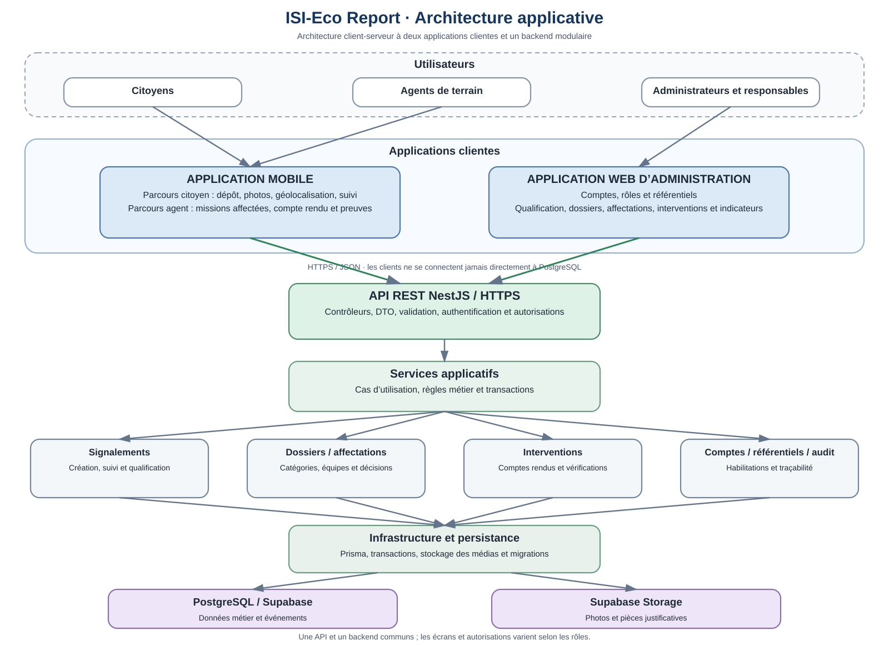

# Architecture

## Architecture applicative

La plateforme comprend une application Web, une application Mobile, l'API NestJS modulaire, PostgreSQL/Supabase, Supabase Auth et Storage privé. Le détail et les flux sont décrits dans [l'architecture applicative](architecture-applicative.md).

## Documents

- [Architecture applicative détaillée](architecture-applicative.md)
- [Organisation cible du monorepo](organisation-monorepo.md)
- [Décisions d'architecture (ADR)](decisions.md)
- [Sécurité et habilitations](securite-et-habilitations.md)
- [État des livrables](etat-des-livrables.md)
- [Principes d'ingénierie](engineering-principles.md)
- [Modèle métier simplifié et migration](modele-metier-simplifie.md)

## Modules actifs

| Module | Responsabilité |
|---|---|
| accounts | Profils, comptes et rôles. |
| referentials | Types de déchets, équipes, appartenances et compétences. |
| reports | Signalements, contenus déclarés, médias et compléments. |
| qualification | Analyse, compléments et décisions. |
| cases | Dossiers, relation directe aux signalements et historique de statut. |
| assignments | Affectation des contenus de dossier aux équipes. |
| interventions | Exécution terrain, preuves et compte rendu. |
| verification | Contrôle indépendant, clôture et reprise. |

Ces frontières sont des modules internes de l'API, pas des services séparés. Le modèle métier Prisma de 18 tables dans `public` ne contient plus de module Audit, de référentiels géographiques, de disponibilités/délégations historisées ou de fonctions de gamification/publication. Une couche d'infrastructure d'audit distincte subsiste : `audit.evenement_metier` dans le schéma PostgreSQL `audit`, hors des 18 modèles métier, journalise les mutations couvertes et expose uniquement la chronologie d'un dossier via Cases.
