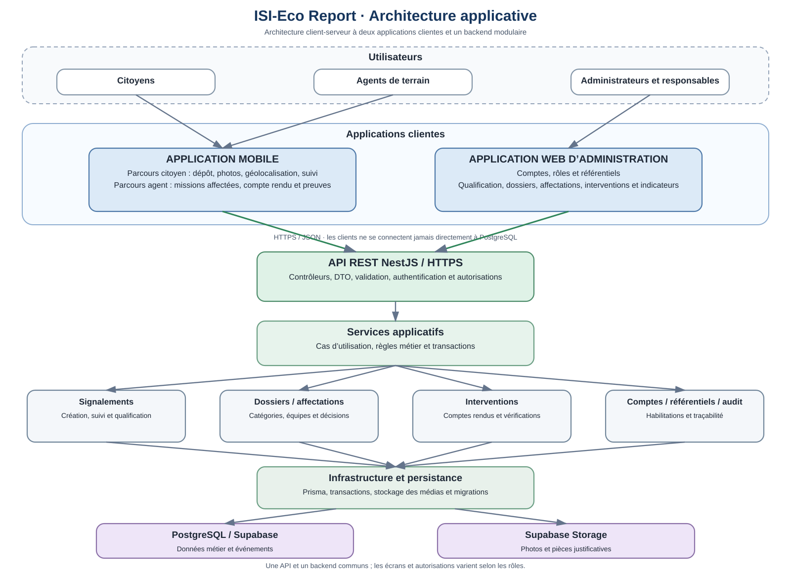

# Architecture

## Architecture applicative cible

La cible comprend une application Web d'administration, une application Mobile unique pour les citoyens et les agents de terrain, et une API REST NestJS déployée comme monolithe modulaire. Les modules partagent un backend et PostgreSQL. Aucun besoin mesuré ne justifie des microservices pour le MVP.

## Documents

- [Architecture applicative détaillée](architecture-applicative.md)
- [Organisation cible du monorepo](organisation-monorepo.md)
- [Décisions d'architecture (ADR)](decisions.md)
- [Sécurité et habilitations](securite-et-habilitations.md)
- [État des livrables](etat-des-livrables.md)
- [Principes d'ingénierie](engineering-principles.md)

## Modules métier

| Module | Responsabilité |
|---|---|
| accounts | Profils, comptes et rôles. |
| reports | Signalements et médias associés. |
| qualification | Analyse, complétude et décision. |
| cases | Création et pilotage des dossiers. |
| assignments | Affectation des catégories aux équipes. |
| interventions | Exécution terrain et compte rendu. |
| verification | Vérification et clôture ou reprise. |
| referentials | Types de déchets, équipes, compétences, géographie. |
| audit | Événements métier et historique. |

Ce sont des frontières applicatives internes, pas des services déployés séparément. Au 31 octobre 2026, les neuf modules backend, le stockage privé et l'API Audit à portée limitée sont intégrés dans main. Le back-office Web comprend le shell et la gestion des comptes/activités (PR #17), ainsi que les parcours Qualification et Cases (PR #18). La Phase 14 (PR #19) a intégré l'administration Web des référentiels. La Phase 15 (PR #20) a intégré le pilotage Web des affectations. La Phase 16 (PR #21) a intégré l'espace Agent terrain et les parcours d'intervention. La Phase 17 (PR #22) a intégré l'interface de vérification indépendante. Les Phases 18 (PR #23) et 19 (PR #24) ont intégré les parcours Mobile citoyen et Agent terrain. La photo native et la géolocalisation ponctuelle sont intégrées (PR #26) ; la recette sur appareils réels et les fonctions d'exploitation restent à réaliser.