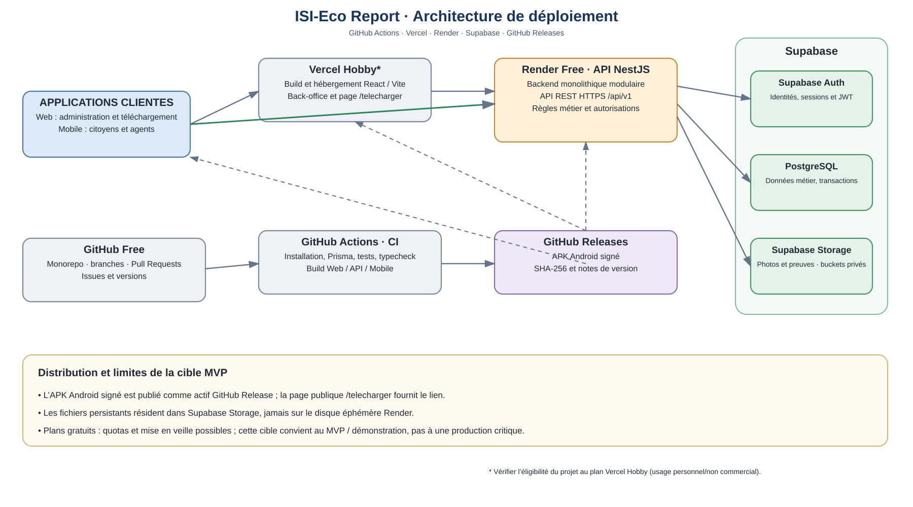

# Déploiement et exploitation

## Schéma de déploiement

La plateforme cible utilise GitHub Actions pour l'intégration continue, Vercel pour le Web, Render pour l'API NestJS et Supabase pour PostgreSQL, Auth et Storage. La disponibilité réelle dépend du plan choisi et doit être vérifiée avant un usage opérationnel.

## Responsabilités des plateformes

| Élément | Plateforme | Responsabilité |
|---|---|---|
| Source et collaboration | GitHub | Dépôt, branches, revues et Releases. |
| Intégration continue | GitHub Actions | Dépendances, migrations PostgreSQL, Prisma, OpenAPI, tests et builds. |
| Frontend Web | Vercel | Back-office React/Vite. |
| Backend | Render | API NestJS modulaire. |
| Base métier | Supabase PostgreSQL | Données relationnelles et transactions. |
| Identité | Supabase Auth | Identifiants, sessions et JWT. |
| Médias | Supabase Storage | Photos et preuves dans des buckets privés. |
| Distribution Android | GitHub Releases | APK signé, versionné, avec SHA-256. |

Les offres gratuites sont adaptées au développement et à la démonstration, pas à une garantie de disponibilité. Vérifier les quotas, conditions d'utilisation et limites de mise en veille avant une mise en service publique.

## Parcours d'une requête

Le client crée une session Supabase Auth et transmet le jeton d'accès à l'API par HTTPS. NestJS vérifie le JWT, résout le profil et les rôles, applique les règles métier, exécute les transactions PostgreSQL et utilise Storage pour les médias. Les clients ne détiennent aucune clé privilégiée. Le disque local Render n'est pas un stockage métier.

## Chaîne de livraison

1. Développement sur une branche et ouverture d'une pull request.
2. CI complète sur le SHA proposé : migrations vierges, répétition historique avec fixtures, tests, OpenAPI, typecheck, builds et diagrammes UML.
3. Revue du code, de la sécurité, des données transformées et de la documentation.
4. Fusion dans `main`.
5. Déploiement Web/API uniquement si l'opt-in de production et les Deploy Hooks sont explicitement configurés.
6. Migration Supabase après backup/restauration vérifié, fenêtre de changement et approbation.
7. Smoke tests de santé, authentification, autorisations, signalement, affectation, intervention et médias.

## Migration staging

Le workflow manuel [Staging Database Migrate](../../.github/workflows/staging-migrate.yml) applique les migrations Prisma versionnées au projet Supabase staging. Il est limité à `main`, utilise l'environnement GitHub `staging` et exige deux choix explicites : `APPLY` et `YES` pour confirmer qu'une sauvegarde a été restaurée dans un environnement isolé. La connexion doit utiliser Supavisor Session Pooler (port 5432), pas le pooler transactionnel. Lire [la procédure staging](staging-database.md) avant toute exécution.

La migration finale transforme l'ancien modèle de 38 tables métier en 18 tables. Elle supprime des historiques et des modules hors périmètre ; elle n'a pas de rollback récupérant les données supprimées. Le workflow staging ne doit pas être exécuté avant une répétition CI réussie et un backup restauré.

Le staging observé contient encore six anciennes migrations et un dataset très réduit : 3 profils métier, 8 rôles, 1 signalement, 1 photo et 6 événements ; aucun dossier, équipe, affectation, intervention ou vérification. Les schémas gérés hébergent aussi 3 identités Auth, 1 bucket et 1 objet Storage. Cette base ne permet pas une recette représentative des relations complexes.

## Sauvegardes

Le projet connecté utilise l'offre Supabase Free. Aucune sauvegarde quotidienne gérée n'est incluse dans cette offre ; une exportation logique manuelle avec Supabase CLI doit être conservée hors dépôt et restaurée dans un projet isolé. Les dumps PostgreSQL ne couvrent pas les comptes Auth ni les objets binaires Storage. Voir les instructions et les liens officiels dans [la procédure staging](staging-database.md).

Avant un usage opérationnel, préparer des sauvegardes indépendantes de la base et des médias, tester leur restauration, superviser les services, gérer et renouveler les secrets, configurer domaine/TLS, rétention et procédure de retour arrière.

## État dans le dépôt

Les workflows `web-deploy.yml` et `api-deploy.yml` existent. Ils attendent la CI réussie sur le SHA exact et exigent `PRODUCTION_DEPLOY_ENABLED=true` ainsi que leurs Deploy Hooks respectifs. Ces garde-fous restent désactivés par défaut. Un workflow terminé avec succès alors que le déploiement est ignoré ne prouve pas une mise en production. Aucun déploiement de production ni smoke test post-déploiement n'est confirmé.

La source de vérité du modèle physique est `prisma/schema.prisma`. La CI applique les migrations sur PostgreSQL vierge et rejoue l'ancien historique sur une autre base jetable avec des données synthétiques ; elle produit aussi les diagrammes depuis les 18 modèles Prisma.

## Comptes E2E staging

Le workflow manuel [Staging E2E Test Users](../../.github/workflows/staging-e2e-users.yml) crée huit comptes Auth isolés, chacun associé à un seul rôle métier actif. Voir [la procédure de provisioning](staging-e2e-users.md) pour les secrets requis, les identifiants de test et les garde-fous staging.
