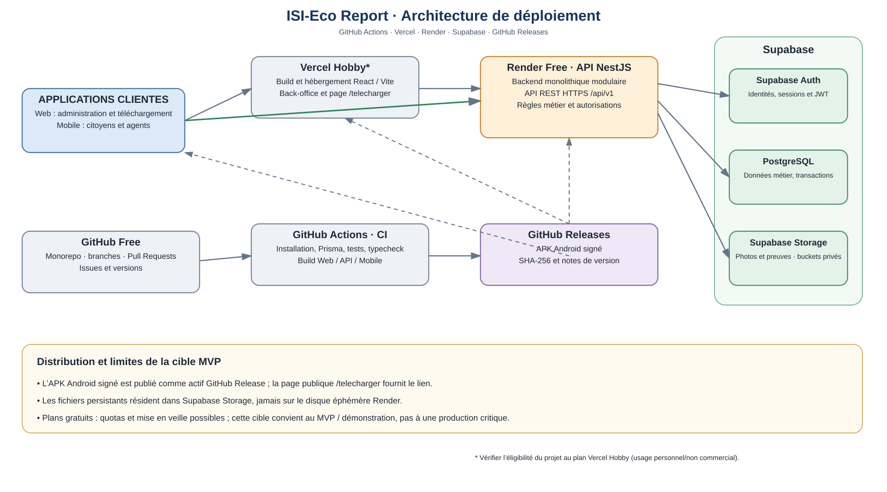

# Architecture de déploiement

## Diagramme

Le diagramme représente la cible du MVP : applications Web et Mobile, Vercel, Render, Supabase, GitHub Actions et publication de l'APK via GitHub Releases.

## Composants

| Élément | Plateforme | Responsabilité |
|---|---|---|
| Source et collaboration | GitHub | Monorepo, branches, revues, issues et versions. |
| Intégration continue | GitHub Actions | Tests, typecheck, builds et contrôle des migrations. |
| Frontend Web | Vercel | Back-office React/Vite et page publique /telecharger. |
| API | Render | Un backend NestJS modulaire exposant REST. |
| Base de données | Supabase PostgreSQL | Données relationnelles, contraintes et transactions. |
| Authentification | Supabase Auth | Identités, sessions et JWT. |
| Médias | Supabase Storage | Photos et preuves dans des buckets privés. |
| APK Android | GitHub Releases | Binaire signé, SHA-256 et notes de version. |

Les plans gratuits sont une cible de développement/démonstration soumise à quotas. Render peut mettre en veille une instance inactive, Supabase peut mettre en pause les projets inactifs et Vercel Hobby est soumis à ses conditions d'usage. Ne pas considérer cette configuration comme une plateforme de production critique.

## Flux

1. Les clients s'authentifient auprès de Supabase Auth.
2. Ils transmettent le JWT à l'API par HTTPS.
3. NestJS valide l'identité et résout les rôles métier en base.
4. L'API applique les permissions, exécute les transactions PostgreSQL et contrôle l'accès aux médias.
5. Le Web est déployé sur Vercel ; l'API sur Render.
6. Une version Android produit un APK signé, calcule son SHA-256 et le publie dans une GitHub Release. La page /telecharger pointe vers cet actif.

Le stockage métier ne doit jamais dépendre du disque local Render.

## Chaîne de livraison

Le workflow CI valide le code avant fusion. Les workflows `web-deploy.yml` et `api-deploy.yml` existent sur la branche Phase 20. Après une CI `main` réussie ou un déclenchement manuel, ils envoient un POST vers `VERCEL_DEPLOY_HOOK_URL` et `RENDER_DEPLOY_HOOK_URL`. Les secrets de smoke test `WEB_SMOKE_URL` et `API_SMOKE_URL` sont facultatifs. Aucune migration de production n'est exécutée automatiquement. Les migrations doivent être appliquées dans une étape dédiée, après tests sur PostgreSQL et sauvegarde de l'environnement cible.

## État actuel

Le diagramme exprime l'architecture cible, pas un déploiement déjà réalisé. Aucun déploiement de production ni APK de release signé n'est confirmé tant que les Deploy Hooks, environnements et secrets ne sont pas configurés et testés.