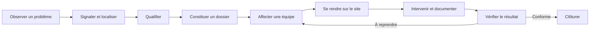

# ISIECO — Product Vision & UX Blueprint

> **Version :** 0.1  
> **Statut :** cadrage produit initial, base de conception à valider  
> **Date :** 12 novembre 2026  
> **Périmètre :** application mobile citoyen/agent et back office Web

Ce document transforme les décisions de cadrage en référence commune pour la conception UX, l'identité visuelle, l'évolution des contrats API et la refonte des interfaces. Il distingue les fonctionnalités actuellement implémentées, les décisions validées et les évolutions proposées. Il ne constitue pas encore une maquette graphique ni une spécification technique exhaustive.

---

## 1. Vision produit

### 1.1 Vision

**ISIECO est une plateforme opérationnelle de gestion de la propreté urbaine et des signalements environnementaux.** Elle relie les citoyens, les équipes de terrain et les responsables opérationnels afin de détecter, localiser, qualifier, traiter et vérifier les problèmes observés sur le terrain.

ISIECO ne doit pas être perçu comme un simple formulaire de signalement associé à un outil administratif. C'est une chaîne opérationnelle traçable qui transforme un constat citoyen en intervention vérifiée.

### 1.2 Promesse produit

- **Pour le citoyen :** signaler facilement un problème et comprendre ce qui est fait pour le résoudre.
- **Pour l'agent de terrain :** savoir quoi traiter, où aller, quoi faire et comment rendre compte.
- **Pour les responsables :** voir la situation opérationnelle, décider et agir depuis un espace de supervision cohérent.

### 1.3 Cycle opérationnel de référence

Chaque écran doit accélérer une étape de ce cycle. Une fonctionnalité qui n'aide ni à agir, ni à décider, ni à comprendre l'état d'une opération doit être secondaire.

### 1.4 Principes directeurs

1. **L'action avant l'administration :** privilégier le geste principal et masquer les détails non indispensables.
2. **La géographie comme contexte de travail :** la carte doit éclairer les décisions et les opérations, pas décorer le dashboard.
3. **La transparence :** chaque acteur doit comprendre le statut réel, la prochaine étape et, lorsqu'elle existe, la personne ou l'équipe responsable.
4. **La simplicité progressive :** demander le minimum au départ ; révéler les informations avancées au moment utile.
5. **La continuité terrain :** concevoir pour les téléphones, l'usage à une main, la lumière extérieure et les connexions instables.
6. **La sécurité par conception :** le client adapte l'interface aux habilitations, mais l'API conserve toute autorité sur les droits.
7. **La cohérence de marque :** une identité ISIECO commune, avec des interfaces adaptées à chaque métier.

---

## 2. Architecture produit et expériences

ISIECO comporte deux produits clients complémentaires :

- **ISIECO Mobile :** une seule application installable, avec une expérience citoyenne ou agent de terrain adaptée aux rôles actifs du compte.
- **ISIECO Web :** le back office de supervision, de traitement et d'administration, conçu autour d'un centre de commandement cartographique.

L'API NestJS reste le socle métier partagé. Les deux clients ne doivent pas réimplémenter les règles métier.

### 2.1 Décision validée : une seule application mobile

La décision produit est de conserver **une seule application mobile**. Après authentification et chargement du profil métier, l'application construit l'espace pertinent à partir des rôles actifs renvoyés par l'API.

Règles de routage proposées :

| Profil actif | Expérience initiale |
|---|---|
| Citoyen uniquement | Accueil citoyen |
| Agent de terrain uniquement | Tableau de bord agent |
| Citoyen et agent | Dernier espace utilisé, avec un sélecteur d'espace toujours accessible |
| Rôle back office uniquement | Écran explicatif indiquant que les opérations sont disponibles sur le Web |
| Aucun profil métier actif | État d'accès contrôlé, avec possibilité de se déconnecter ou de contacter l'administration |

Le sélecteur d'espace ne donne aucun droit supplémentaire. Il ne fait que changer le contexte d'interface ; chaque endpoint continue à vérifier les rôles, l'appartenance et les états métier côté serveur.

Le choix du dernier espace peut être conservé dans le stockage local de l'application. Il ne faut jamais conserver localement une autorisation comme si elle était une preuve d'habilitation.

### 2.2 Rôles métier connus

Le modèle actuel expose huit rôles fonctionnels :

| Rôle | Responsabilité produit | Client principal |
|---|---|---|
| `CITOYEN` | Déposer et suivre ses signalements, répondre aux demandes de complément | Mobile |
| `AGENT_TERRAIN` | Consulter les missions de ses équipes, intervenir et envoyer des preuves | Mobile |
| `AGENT_QUALIFICATION` | Examiner, compléter, accepter ou rejeter un signalement | Web |
| `RESPONSABLE_TRAITEMENT` | Constituer et piloter les dossiers, priorités et localisations | Web |
| `RESPONSABLE_AFFECTATION` | Répartir les contenus de dossier entre les équipes éligibles | Web |
| `GESTIONNAIRE_REFERENTIEL` | Gérer types de déchets, équipes, appartenances et compétences | Web |
| `VERIFICATEUR_CLOTURE` | Contrôler indépendamment les interventions et décider conformité ou reprise | Web |
| `ADMINISTRATEUR_COMPTES` | Administrer les comptes et leurs rôles | Web |

Un même compte peut porter plusieurs rôles actifs. L'interface peut agréger les capacités correspondantes sans supposer que tous les utilisateurs ont le même parcours.

---

## 3. Personas et besoins prioritaires

### 3.1 Citoyen

**Objectif :** signaler un dépôt ou un problème de propreté sans connaître les procédures internes.

Attentes principales :
- comprendre immédiatement comment signaler ;
- joindre une photo en premier ;
- localiser automatiquement le problème et pouvoir corriger le point ;
- ne pas remplir des champs administratifs ;
- recevoir une confirmation compréhensible ;
- suivre les étapes et les demandes de complément.

Indicateur de réussite : déposer un signalement complet et correctement localisé avec le moins d'interactions possible.

### 3.2 Agent de terrain

**Objectif :** traiter les missions affectées à son équipe.

Attentes principales :
- voir immédiatement les missions à accepter, en cours et à terminer ;
- identifier le type de déchets, la priorité et le lieu ;
- ouvrir un itinéraire en un geste ;
- comprendre les consignes avant de démarrer ;
- documenter l'intervention avec des preuves ;
- soumettre un compte rendu sans ressaisir des informations inutiles.

Indicateur de réussite : passer rapidement de la réception d'une mission à son exécution, puis à un compte rendu vérifiable.

### 3.3 Responsable opérationnel

**Objectif :** piloter la charge et les opérations sur le territoire.

Attentes principales :
- visualiser les signalements et dossiers sur une carte ;
- repérer les urgences, retards, concentrations et zones sans couverture ;
- comprendre les états des affectations et interventions ;
- effectuer les opérations autorisées sans naviguer entre une succession de pages ;
- ouvrir un panneau de détail contextuel depuis la carte ;
- disposer d'une trace des décisions effectuées.

Indicateur de réussite : décider et agir depuis une vue opérationnelle unifiée.

### 3.4 Agents métier spécialisés

Les agents de qualification, responsables de traitement, responsables d'affectation, gestionnaires de référentiels et vérificateurs ont des responsabilités différentes. Leur interface doit exposer les actions liées à leur tâche principale et non un catalogue uniforme de modules.

---

## 4. Parcours UX cibles

## 4.1 Parcours citoyen : signaler en quelques secondes

### Écran d'accueil

L'accueil citoyen doit répondre immédiatement à trois questions : « Que puis-je faire ? », « Où en est mon signalement ? » et « Que se passe-t-il autour de moi ? ».

Contenu recommandé :
- message d'accueil bref et contextualisé ;
- action principale très visible : **Signaler un dépôt** ;
- aperçu des signalements en cours et récemment résolus ;
- accès direct à « Mes signalements » ;
- carte ou aperçu local, à condition que les données et permissions nécessaires soient disponibles ;
- informations environnementales locales uniquement si elles sont alimentées par une source fiable.

### Formulaire de signalement

Le formulaire devient un écran simple, organisé dans cet ordre :

1. **Photo :** ouvrir la caméra ou choisir une image de la galerie ; afficher immédiatement un aperçu.
2. **Localisation :** proposer la position courante après consentement, puis permettre de déplacer le marqueur ou de saisir un lieu.
3. **Description facultative :** champ court, repliable ou secondaire.
4. **Type de déchets facultatif :** choix par chips ou icônes, sans bloquer l'envoi.
5. **Envoyer :** bouton fixe ou facilement accessible, avec un état de progression clair.

Principes :
- pas de date de constat demandée dans le parcours rapide ; la date de soumission est enregistrée automatiquement ;
- pas de coordonnées latitude/longitude saisies manuellement par défaut ;
- ne pas afficher la précision GPS comme un champ à remplir ;
- autoriser un dépôt si l'utilisateur refuse l'accès à la caméra ou à la localisation, sous réserve des règles métier finales ;
- prévoir un état de confirmation avec référence et prochain statut ;
- préserver les données saisies lorsque l'envoi échoue.

**Point bloquant identifié : le contrat actuel ne permet pas encore ce formulaire.** `CreateReportDto` exige une description d'au moins 10 caractères et au moins un type de déchet ; le service rejette également un signalement sans catégorie. La refonte devra faire évoluer ces contraintes pour rendre description et catégories facultatives. La base autorise déjà une description nulle et une relation sans contenu, mais les parcours de qualification devront être testés avec des signalements sans catégorie. Cette évolution est une modification API/métier, pas uniquement un changement d'interface.

### Photo : séquence technique

L'API actuelle crée le signalement avant de recevoir les photos : l'upload utilise `POST /reports/:id/photos`. L'interface peut néanmoins présenter la capture comme première étape : les photos sont préparées localement, le signalement est créé, puis les photos sont envoyées et leur progression est affichée. Une API de pré-upload ou de brouillon n'est nécessaire que si l'on décide d'exiger une validation serveur de la photo avant toute création du signalement.

### Suivi du signalement : timeline

L'écran détail doit présenter :
- une carte ou un aperçu de la localisation ;
- les photos déposées ;
- le statut actuel en évidence ;
- une timeline chronologique et lisible ;
- les demandes de complément et la réponse du citoyen ;
- une explication de la prochaine étape lorsqu'elle est connue.

La timeline ne doit afficher que des événements compréhensibles et communicables au citoyen. Les événements internes, motifs confidentiels ou informations personnelles d'agents ne doivent pas être exposés.

**Écart actuel :** l'historique des changements de statut est stocké dans `HistoriqueStatutSignalement`, mais `GET /reports/:id` renvoie principalement le statut courant et le détail du signalement. Aucun endpoint de timeline citoyenne n'est documenté. Il faut prévoir un endpoint propriétaire, par exemple `GET /reports/:id/timeline`, qui projette les événements autorisés et vérifie la propriété du signalement. Ne pas détourner l'endpoint d'historique des dossiers, réservé au responsable de traitement.

## 4.2 Parcours agent : recevoir, naviguer, intervenir

### Accueil agent

L'accueil agent doit être un poste de travail compact :

- missions à accepter ;
- missions acceptées à démarrer ;
- interventions en cours ;
- comptes rendus soumis ou en attente de vérification ;
- alertes et éléments nécessitant une action.

Chaque mission doit exposer d'abord : priorité, type de déchet, référence dossier, description courte, état et lieu.

Les missions doivent être filtrables par état et équipe. Si l'agent appartient à plusieurs équipes, le changement d'équipe doit être simple et visible, sans obliger à comprendre les identifiants techniques.

### Détail d'une mission

Le détail doit présenter :
- photo(s) du signalement lorsque consultables ;
- description et type de déchets ;
- adresse/description du lieu et coordonnées ;
- priorité, référence dossier et état de l'affectation ;
- historique utile de la mission ;
- boutons d'action contextuels.

### Navigation vers le dépôt

Un bouton primaire **Démarrer l'itinéraire** doit ouvrir l'application de navigation disponible sur le téléphone, avec les coordonnées du dossier. Une carte intégrée peut être proposée en second niveau.

**Écart actuel :** les coordonnées existent sur le modèle du dossier, mais les DTO utilisés pour les affectations et interventions agent ne les exposent pas. Le client agent n'a donc pas aujourd'hui une source contractuelle suffisante pour construire l'itinéraire. Il faut enrichir le DTO de mission ou fournir un endpoint de détail de mission autorisé pour le membre actif de l'équipe. Les données du dossier ne doivent pas être ouvertes à l'agent via une route réservée à un autre rôle.

### Exécution d'une intervention

Le parcours cible :
1. accepter ou refuser la mission (refus motivé) ;
2. ouvrir l'itinéraire ;
3. confirmer l'arrivée et démarrer l'intervention ;
4. ajouter une ou plusieurs photos de preuve, avec leur contexte ;
5. saisir un compte rendu guidé ;
6. choisir le résultat : terminée, partielle ou impossible ;
7. fournir un motif lorsque le résultat n'est pas terminé ;
8. envoyer le compte rendu pour vérification.

Le compte rendu peut proposer des suggestions ou des champs structurés, mais l'agent ne doit pas être forcé à remplir une longue fiche sur place. Les règles de preuve et de compte rendu restent conformes au contrat API et évoluent séparément si elles deviennent trop lourdes.

### Usage terrain et réseau

Le MVP actuel ne fournit pas de mode hors connexion complet. La cible UX doit prévoir :
- conservation locale temporaire d'un brouillon non soumis ;
- cache limité des missions récemment consultées ;
- file d'envoi des photos et comptes rendus ;
- idempotence et reprise après échec ;
- affichage clair de l'état de synchronisation ;
- résolution explicite des conflits de statut.

Ne pas permettre hors ligne une transition métier irréversible sans stratégie de synchronisation et de contrôle de concurrence validée.

## 4.3 Parcours back office : centre de commandement

### Objectif

Le Web devient un **centre de supervision et de pilotage des opérations**, et non un ensemble de tableaux CRUD juxtaposés.

### Écran principal

Structure fonctionnelle recommandée :

- **Barre supérieure :** marque ISIECO, environnement, recherche, alertes, profil et espace actif.
- **Bandeau KPI :** signalements à qualifier, dossiers ouverts, affectations en attente, interventions en cours, vérifications à effectuer.
- **Zone principale :** carte opérationnelle large et dominante.
- **Panneau latéral :** activité récente, alertes, liste filtrée ou détail du point sélectionné.
- **Filtres persistants :** période, territoire disponible, statut, priorité, type de déchets, équipe et couche cartographique.
- **Actions :** accessibles dans le contexte du point ou du dossier, selon les permissions du compte.

### Couches cartographiques

| Couche | Représentation | Données requises |
|---|---|---|
| Signalements | Marqueurs groupés par proximité, couleur selon statut | Coordonnées du signalement, statut, date, catégorie |
| Dossiers | Marqueurs/cluster avec priorité et statut | Coordonnées du dossier, priorité, état |
| Affectations | Indicateurs sur le site avec état de la mission | Affectation, contenu de dossier et localisation |
| Interventions | État de l'intervention associé au site | Intervention, résultat et coordonnées du dossier |
| Équipes | Position courante uniquement si le suivi de position est mis en place et autorisé | Télémétrie de position distincte, horodatage et consentement |

Les clusters, légendes, couleurs et icônes doivent être cohérents et compréhensibles. Une légende permanente et des filtres évitent de transformer la carte en nuage de marqueurs illisible.

### Interactions sur la carte

Un clic sur un signalement, dossier ou site doit ouvrir un panneau de contexte, sans perdre la carte ni les filtres.

Ce panneau peut présenter :
- référence et statut ;
- photo(s) ;
- description et type de déchets ;
- date de création et localisation ;
- historique autorisé ;
- affectations et interventions associées ;
- actions disponibles pour le rôle actif.

Les opérations doivent respecter le cycle métier. Exemples :
- qualification : examiner, demander un complément, accepter ou rejeter ;
- traitement : créer un dossier, modifier priorité/localisation, rattacher ou détacher un signalement ;
- affectation : choisir une équipe compétente et affecter un contenu ;
- vérification : consulter les preuves, valider ou demander une reprise.

Les opérations de référentiel et d'administration de comptes restent dans des vues dédiées, reliées au centre de commandement.

### Ce que signifie « temps réel »

Il faut distinguer trois niveaux :
1. **Actualisation manuelle :** état au dernier chargement.
2. **Actualisation quasi temps réel :** rafraîchissement périodique des couches et des compteurs.
3. **Temps réel :** diffusion d'événements et, le cas échéant, de positions récentes des agents.

Le dépôt actuel documente des endpoints REST et des vues de traitement, mais pas d'API cartographique agrégée, de canal temps réel ou de télémétrie des positions des agents. La première version de la carte peut fonctionner à partir des données métier et d'un rafraîchissement contrôlé. Le temps réel et le suivi de position sont des évolutions backend distinctes.

**Règle de confidentialité :** ne pas afficher ni collecter une position continue d'un agent par défaut. Toute géolocalisation opérationnelle doit être justifiée, annoncée, limitée au temps de mission ou de service défini, protégée par les permissions appropriées et assortie d'une politique de rétention. Toujours afficher l'heure de la dernière position reçue. Une position ancienne ne doit jamais être présentée comme temps réel.

---

## 5. Architecture de navigation

## 5.1 Mobile — espace citoyen

Bottom navigation proposée :

| Onglet | Contenu |
|---|---|
| Accueil | Action principale, résumé et informations utiles |
| Signaler | Ouverture directe du formulaire rapide, visuellement prioritaire |
| Suivi | Liste et timeline des signalements |
| Profil | Identité, préférences, aide et déconnexion |

Le bouton Signaler peut être visuellement mis en avant au centre, sans masquer les autres onglets ni gêner les technologies d'assistance.

## 5.2 Mobile — espace agent

Bottom navigation proposée :

| Onglet | Contenu |
|---|---|
| Accueil | Vue synthétique de la journée et actions requises |
| Missions | Liste par statut et détail d'une affectation |
| Carte | Missions géolocalisées et accès aux itinéraires |
| Profil | Identité, équipe active, espace et paramètres |

Les alertes importantes peuvent être visibles dans l'accueil et les détails de mission, sans ajouter un onglet de navigation supplémentaire.

## 5.3 Web

Navigation principale proposée :

- Centre de commandement ;
- Signalements / qualification ;
- Dossiers ;
- Affectations ;
- Interventions et vérifications ;
- Équipes et référentiels ;
- Administration des comptes ;
- Rapports et indicateurs.

Les entrées ne s'affichent que si le profil dispose des droits correspondants. Le centre de commandement adapte ses commandes et couches selon les rôles actifs.

Les menus doivent privilégier des groupes compréhensibles plutôt que la simple reproduction des noms des modules backend.

---

## 6. Identité visuelle et design system

### 6.1 Positionnement visuel

La direction proposée est **urbaine, environnementale, institutionnelle et contemporaine**. ISIECO doit évoquer une plateforme de terrain crédible, proche des citoyens et maîtrisant ses opérations.

Éviter :
- le vert générique utilisé partout ;
- les écrans saturés de cartes, badges et ombres ;
- les dégradés décoratifs sans fonction ;
- les icônes emoji dans les interfaces métier ;
- les titres géants et les paragraphes trop longs dans les vues opérationnelles ;
- les couleurs de statut choisies sans règle cohérente.

### 6.2 Palette exploratoire

Cette palette est une hypothèse de départ pour les premiers prototypes, pas une identité finale approuvée :

| Token | Couleur de départ | Rôle |
|---|---|---|
| `brand-forest` | `#14532D` | Marque, actions primaires |
| `brand-petrol` | `#164E63` | Navigation, profondeur et data |
| `brand-lime` | `#A3E635` | Accent ponctuel |
| `surface-base` | `#F7F8F5` | Fond général |
| `surface-card` | `#FFFFFF` | Panneaux et surfaces |
| `text-primary` | `#17231C` | Texte principal |
| `text-muted` | `#647067` | Texte secondaire |
| `status-info` | à définir | Information |
| `status-warning` | à définir | Attention |
| `status-danger` | à définir | Blocage/urgence |
| `status-success` | à définir | Résolution validée |

Les couleurs d'état doivent être définies par token et accompagnées d'un libellé ou d'une icône : la couleur seule ne communique jamais un statut. Les contrastes doivent être vérifiés avant validation de la palette.

### 6.3 Typographie

Une seule famille sans-serif principale est à privilégier sur Web et Mobile, avec une hiérarchie explicite : titres, sous-titres, corps, légendes, données et libellés d'action. Inter est déjà déclarée dans le CSS Web et constitue un candidat initial ; le choix final sera validé sur mobile, desktop et en contexte extérieur.

Les nombres opérationnels (compteurs, références, dates) doivent rester très lisibles. Éviter les longs paragraphes et les textes en capitales pour les informations courantes.

### 6.4 Icônes, illustrations et photographie

- Utiliser une bibliothèque d'icônes cohérente sur les deux clients, avec des pictogrammes métier dédiés pour dépôts, équipes, véhicules, interventions, validation et alertes.
- Ne pas mélanger emoji, icônes pleines et linéaires au hasard.
- Créer un petit ensemble d'illustrations d'état vide et d'onboarding.
- Employer des photographies éditoriales authentiques de contexte urbain et environnemental, avec traitement visuel cohérent et sans stigmatiser les quartiers ou les personnes.
- Les pictogrammes de carte doivent être distincts des icônes de navigation.

### 6.5 Composants fondamentaux

Le design system doit au minimum définir :
- tokens couleur, typographie, espacement, rayon, élévation et états ;
- boutons primaires, secondaires, destructifs et liens ;
- champs texte, sélection, chips et formulaires ;
- bottom navigation et navigation Web ;
- cartes de signalement, mission et dossier ;
- badges de statut, priorité et rôle ;
- timeline et historique ;
- panneau latéral et bottom sheet ;
- listes, tableaux, pagination et filtres ;
- composants carte, marqueur, cluster et légende ;
- alertes, notifications, toasts et états de chargement ;
- états vides, erreurs, hors ligne et synchronisation ;
- dialogue de confirmation et retours d'action.

Les composants partagent les mêmes tokens et règles visuelles, mais pas nécessairement le même rendu : une carte de mission mobile et une ligne de tableau Web ont des contraintes d'usage différentes.

### 6.6 Accessibilité et adaptabilité

Cibles de conception :
- contraste WCAG 2.2 AA pour les textes et composants ;
- zones tactiles suffisamment grandes ;
- labels accessibles et ordre de lecture cohérent ;
- prise en charge du redimensionnement du texte ;
- états de focus visibles sur Web ;
- alternative textuelle aux informations de carte ;
- usage sur petits écrans et fenêtres réduites ;
- non-dépendance à la couleur, au survol ou aux gestes complexes.

---

## 7. État actuel du produit et écarts à traiter

État vérifié à partir de la branche `main` au 12 novembre 2026. Cette section décrit le dépôt ; elle ne remplace pas une recette visuelle sur appareils réels.

| Domaine | État actuel constaté | Écart / conséquence |
|---|---|---|
| Mobile | Expo Router, application unique, groupes `(citizen)` et `(agent)` | Base conservée ; navigation et routage par espace à refondre |
| Splash/onboarding | Aucun parcours de marque/onboarding dédié identifié dans les routes actuelles | À concevoir |
| Mobile citoyen | Création et suivi des signalements, photos, localisation ponctuelle, compléments | Formulaire trop exigeant ; ordre et champs à revoir |
| Signalement API | Description >= 10 caractères et au moins un type requis | Contrat à assouplir pour rendre ces champs facultatifs |
| Upload photo | Endpoint privé post-création du signalement, jusqu'à trois photos via le client actuel | Capture d'abord possible côté UX ; upload serveur après obtention de l'identifiant |
| Timeline citoyenne | Historique de statut stocké ; pas d'endpoint de timeline propriétaire documenté | Projection API dédiée à créer |
| Missions agent | Consultation des équipes, affectations et interventions, acceptation/refus, démarrage, compte rendu, preuves | Accueil, détail et navigation à simplifier |
| Géolocalisation mission | Coordonnées du dossier stockées ; non exposées dans les DTO de mission agent consultés | Enrichir le contrat agent pour l'itinéraire |
| Navigation GPS | Pas de flux de navigation ni d'intégration cartographique identifié dans les parcours actuels | Deep link vers l'application de navigation à concevoir |
| Mode hors ligne | Non implémenté | À traiter après le parcours connecté de référence |
| Web | React/Vite, navigation par rôle, pages comptes/qualification/dossiers/affectations/référentiels/interventions/vérification | Architecture d'information et shell à refondre |
| Dashboard Web | Vue de profil, rôles et liens vers les espaces | Ne constitue pas un centre de commandement opérationnel |
| Carte Web | Pas de module ou endpoint cartographique agrégé identifié | Read model géospatial et UI cartographique à créer |
| Temps réel | Pas de canal temps réel ni de télémétrie d'équipe documentés | À spécifier séparément |
| Design system | Tailwind/NativeWind et styles locaux ; Inter déclarée côté Web | Tokens, composants, règles et branding communs à formaliser |

### 7.1 Contraintes métier à ne pas casser

La refonte UX ne doit pas supprimer ou contourner :
- l'idempotence du dépôt et des opérations d'affectation ;
- les contrôles de propriété du signalement ;
- l'appartenance active de l'agent à l'équipe ;
- la séparation qualification / traitement / affectation / intervention / vérification ;
- l'interdiction d'auto-vérification ;
- la confidentialité des photos et l'usage des URL signées temporaires ;
- la validation côté serveur des états et transitions métier.

---

## 8. Évolutions backend nécessaires

Les exigences suivantes doivent être planifiées comme des travaux backend explicites.

| Priorité | Évolution | Justification |
|---|---|---|
| P0 | Autoriser description et catégories facultatives sur la création d'un signalement | Pré-requis au formulaire citoyen rapide |
| P0 | Exposer une timeline citoyenne limitée aux événements communicables et au propriétaire | Pré-requis au suivi demandé |
| P0 | Exposer les coordonnées et informations de lieu dans le détail de mission agent, avec contrôle d'appartenance | Pré-requis à l'itinéraire |
| P1 | Définir un read model cartographique des signalements, dossiers, affectations et interventions | Pré-requis au centre de commandement |
| P1 | Définir filtres, pagination/viewport, agrégation et règles d'accès du read model cartographique | Éviter de charger toute la base depuis le client |
| P1 | Définir la stratégie de rafraîchissement de la carte (polling ou diffusion d'événements) | Actualisation opérationnelle cohérente |
| P2 | Ajouter la télémétrie de position des équipes si elle est réellement nécessaire | Nécessite une décision de confidentialité, de consentement, de cadence et de rétention |
| P2 | Concevoir la persistance locale, file de synchronisation et résolution de conflits | Pré-requis à un mode hors ligne robuste |
| P2 | Évaluer les notifications push pour les affectations et changements de statut | Réduire le délai de réaction sans imposer une consultation constante |

Aucune de ces capacités ne doit être présentée comme existante avant implémentation et validation.

---

## 9. Feuille de route de refonte

Les quatre étapes de travail validées sont conservées. Chaque étape se termine par un livrable validable avant le passage à la suivante.

### Étape 1 — Vision produit et architecture

**Livrables**
- vision et promesse produit ;
- personas et responsabilités ;
- matrice rôles/espaces/actions ;
- cycle opérationnel et parcours prioritaires ;
- liste des gaps métier/API ;
- périmètre MVP de la refonte et décisions ouvertes.

**Critère de sortie :** les parties prenantes valident les parcours et les responsabilités de chaque écran.

### Étape 2 — UX et architecture de l'information

**Livrables**
- sitemap Web et navigation mobile ;
- user flows citoyens, agents et responsables ;
- wireframes basse fidélité ;
- états vides, chargements, erreurs, absence de permissions, mode réseau faible ;
- interactions de la carte et du panneau contextuel ;
- critères de test utilisateur.

**Critère de sortie :** un utilisateur peut expliquer et exécuter les parcours clés dans un prototype sans aide du concepteur.

### Étape 3 — Identité visuelle et design system

**Livrables**
- direction artistique et logo/usage de marque validés ;
- palette et typographie finales ;
- règles d'icônes et d'illustrations ;
- tokens Web/Mobile ;
- composants et variantes ;
- prototypes haute fidélité et états responsive.

**Critère de sortie :** les écrans clés sont cohérents et le design system couvre les éléments récurrents.

### Étape 4 — Implémentation progressive

Ordre recommandé :
1. fondations design system, navigation et authentification adaptative ;
2. mobile citoyen : accueil, capture photo, localisation, dépôt rapide et suivi ;
3. mobile agent : accueil, missions, itinéraire, intervention et preuves ;
4. Web centre de commandement : carte, filtres, panneaux contextuels et actions par rôle ;
5. modules spécialisés Web et administration ;
6. notifications, actualisation avancée, offline et télémétrie selon priorités validées.

**Critère de sortie :** tests fonctionnels, tests d'autorisations, validation responsive/native et recette utilisateur réussis.

---

## 10. Critères de réussite UX

Les valeurs chiffrées ci-dessous sont des **cibles proposées pour les tests**, à confirmer après les premières sessions utilisateur.

### Mobile citoyen
- un nouveau signalement peut être envoyé sans description et sans choix de catégorie ;
- la photo est l'action mise en avant, sans rendre le signalement impossible lorsque la permission est refusée ;
- le point de localisation peut être vérifié et ajusté ;
- la confirmation est compréhensible et le signalement apparaît dans le suivi ;
- cible de test : la majorité des utilisateurs testeurs termine un premier signalement en moins de 30 secondes lorsque caméra et GPS sont disponibles.

### Mobile agent
- les missions nécessitant une action sont visibles dès l'accueil ;
- les coordonnées du site sont consultables sans ressaisie ;
- l'itinéraire est ouvrable en un geste ;
- l'agent ne peut pas soumettre un compte rendu dans un état métier invalide ;
- l'état de l'upload et de la synchronisation est explicite.

### Web
- le responsable identifie rapidement les urgences et les opérations en cours ;
- les filtres cartographiques et les compteurs restent synchronisés ;
- chaque action depuis la carte indique son contexte, sa conséquence et son résultat ;
- les actions interdites ne sont pas proposées et restent protégées côté API ;
- l'interface est utilisable sur écran large et sur format laptop.

### Qualité transversale
- aucun statut n'est communiqué uniquement par la couleur ;
- les états de chargement, erreur, vide et hors connexion sont conçus ;
- les parcours critiques sont testés avec des comptes de chaque rôle ;
- les changements de permissions sont pris en compte sans conserver des accès périmés côté client.

---

## 11. Décisions ouvertes à valider avant les maquettes finales

Ces points ne doivent pas être inventés par l'équipe de conception :

1. **Photo obligatoire ou recommandée :** la photo est la première action du parcours, mais faut-il autoriser un signalement sans photo ?
2. **Localisation obligatoire ou facultative :** la position GPS doit être proposée automatiquement, mais quelle règle appliquer si elle est indisponible ?
3. **Types de déchets :** le citoyen peut ne rien sélectionner et laisser la qualification métier faire le travail ; confirmer que c'est la règle cible.
4. **Visibilité citoyenne de la timeline :** quels événements opérationnels, noms d'équipe et détails sont communicables ?
5. **Temps réel Web :** un rafraîchissement périodique suffit-il en première livraison, ou la diffusion live est-elle indispensable dès le MVP ?
6. **Position des agents :** faut-il réellement afficher la position des agents ou seulement les sites et états de leurs missions ?
7. **Cartographie :** choisir le fournisseur, les contraintes de coût, le géocodage, le style de carte et le comportement en zone de faible connectivité.
8. **Territoire et identité :** valider le territoire de lancement, les codes visuels locaux, le nom de marque affiché et les usages du logo.
9. **Langues :** confirmer si la première version doit être uniquement en français ou prévoir une localisation multilingue.

---

## 12. Hors périmètre de ce cadrage initial

Sauf décision spécifique, ce blueprint ne spécifie pas :
- la gamification ou les récompenses citoyennes ;
- un réseau social ou des commentaires publics ;
- le suivi permanent des déplacements des agents ;
- des prévisions de collecte ou d'optimisation d'itinéraires par IA ;
- des statistiques territoriales non alimentées par des données fiables ;
- une publication de données ou photos publiques par défaut.

---

## 13. Références internes auditées

Les constats de l'état actuel sont fondés notamment sur :
- `apps/mobile/README.md` et les routes `apps/mobile/app/` ;
- `apps/mobile/app/(citizen)/reports/new.tsx` et `apps/mobile/app/(agent)/missions/index.tsx` ;
- `apps/web/src/app/navigation.ts`, `AppShell.tsx` et `features/dashboard/DashboardPage.tsx` ;
- `docs/api/README.md` et les contrôleurs/DTO NestJS des modules Reports, Assignments, Interventions, Cases et Verification ;
- `docs/architecture/architecture-applicative.md` et `docs/architecture/securite-et-habilitations.md` ;
- `prisma/schema.prisma`.

Le contrat OpenAPI généré depuis les contrôleurs et DTO reste la source de vérité des endpoints. Toute divergence découverte lors de l'implémentation doit être corrigée dans le contrat et les tests, pas masquée dans le frontend.

---

## Annexe A — Wireframes basse fidélité

Le premier jeu de wireframes est disponible dans [ISIECO — UX Wireframes (Low Fidelity)](https://www.figma.com/design/3nnUEI6AEwHeUOYJEZQrkf).

Le fichier contient six écrans éditables, regroupés par plateforme :

### Mobile — page « 01 · Mobile »

1. **Citoyen — Accueil :** action de signalement mise en avant, aperçu de l'activité et navigation inférieure.
2. **Citoyen — Nouveau signalement :** photo en premier, localisation, description facultative, types de déchets facultatifs et action d'envoi.
3. **Citoyen — Suivi du signalement :** emplacement, statut et timeline de traitement.
4. **Agent — Mes missions :** compteurs de missions, filtres et cartes de mission.
5. **Agent — Détail et itinéraire :** destination, ouverture de l'itinéraire, consignes et acceptation.

### Web — page « 02 · Centre de commandement Web »

6. **Centre de commandement :** navigation métier, indicateurs opérationnels, grande zone cartographique, filtres, flux d'activité et panneau contextuel du point sélectionné.

Ces wireframes sont volontairement basse fidélité. Les fonds de carte et marqueurs sont des placeholders éditables, pas une intégration cartographique ni des données réelles. Les métriques et événements sont des exemples de conception. Les composants de navigation et de boutons proviennent de bibliothèques Figma réutilisables.

### Limites de validation

Le centre de commandement Web a fait l'objet d'un contrôle visuel après composition. La génération de captures supplémentaires a ensuite été bloquée par la limite d'appels Figma du plan Starter ; les cinq vues mobiles sont donc livrées comme frames éditables, mais leur contrôle visuel détaillé reste à effectuer lors de la revue dans Figma.

La prochaine revue doit valider les séquences, les libellés, les états vides/erreurs et les interactions. Elle devra ensuite conduire à des wireframes enrichis (navigation entre écrans, états alternatifs, responsive Web) avant la direction artistique et les maquettes haute fidélité.

Le graphe de navigation attendu et les limites des parcours sont détaillés dans [Prototype interaction map](prototype-interactions.md). La carte sépare les connexions applicables aux six frames actuelles des écrans supplémentaires requis pour les scénarios complets d'intervention et de pilotage Web.
