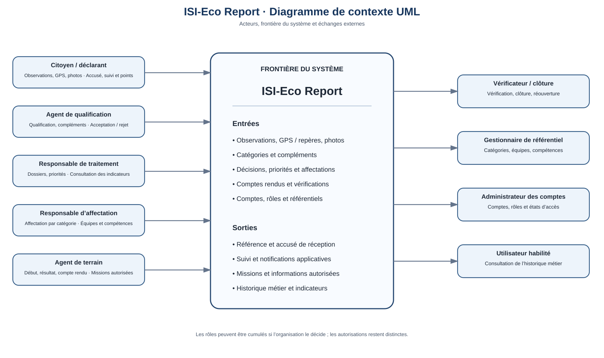
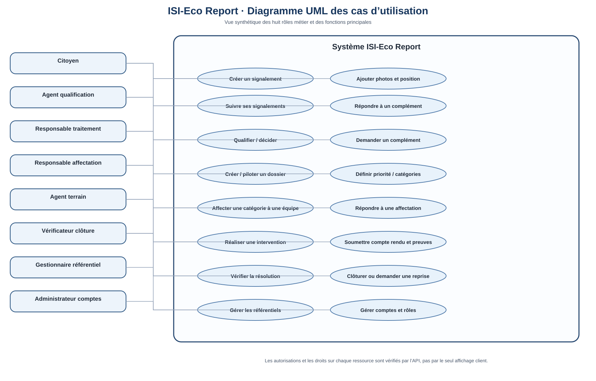
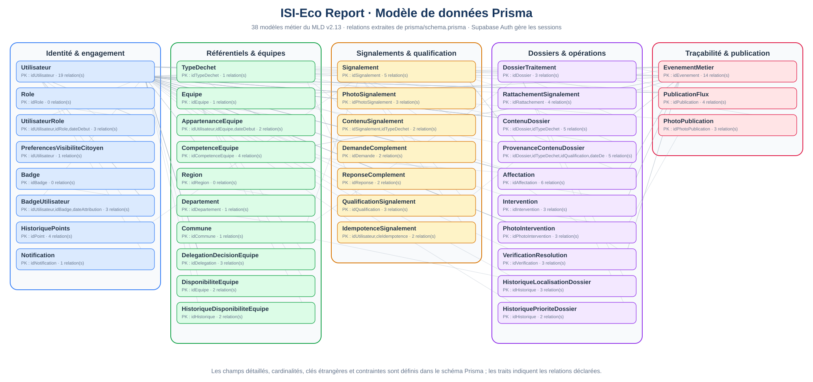

# Livrables UML

Les diagrammes sont intégrés comme SVG vectoriels, affichables directement dans GitHub et lisibles au zoom. Les sources textuelles Mermaid restent présentes à côté des images.

## Diagramme de contexte

Source et explications : [contexte-systeme.md](contexte-systeme.md).

## Diagramme de cas d'utilisation

Source et préconditions : [cas-utilisation.md](cas-utilisation.md).

## Diagramme de classes / données

Cette vue est générée à partir du schéma Prisma actuel et représente les 38 modèles métier et leurs relations. Le détail des colonnes, clés et contraintes demeure dans le schéma Prisma et le [MLD v2.13](../merise/README.md).

## Note sur les livrables historiques

Les fichiers de conception initiaux contiennent également des vues détaillées des cas d'utilisation par rôle et des diagrammes de classes historiques. La vue de données ci-dessus a été régénérée à partir du schéma Prisma actuel afin d'éviter qu'un ancien diagramme incomplet soit interprété comme le modèle définitif.

Toute évolution des acteurs ou associations doit rester alignée sur les huit rôles et les 38 modèles métier.