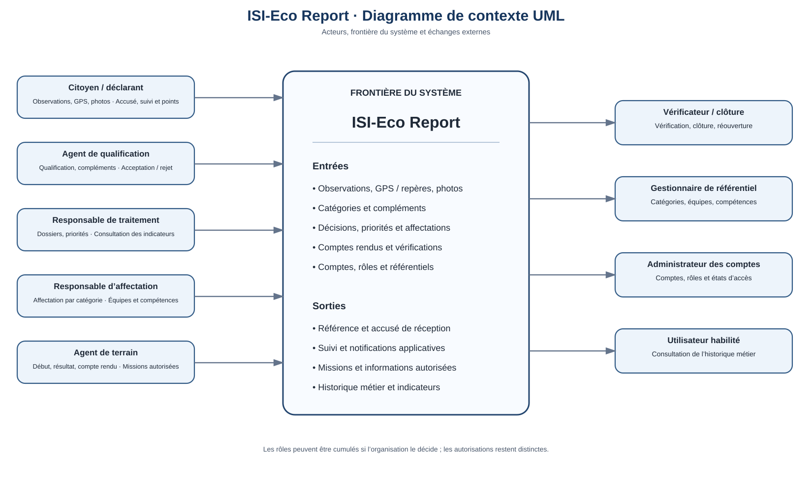
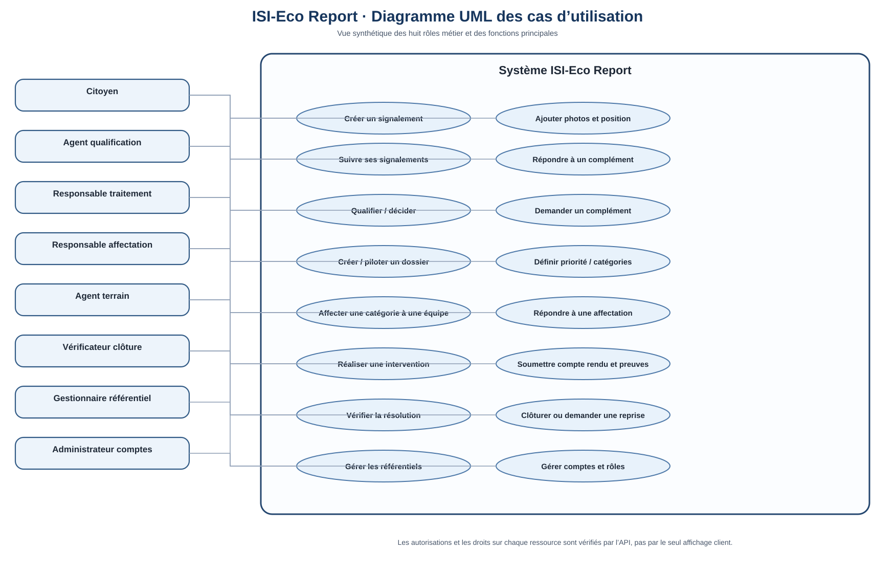
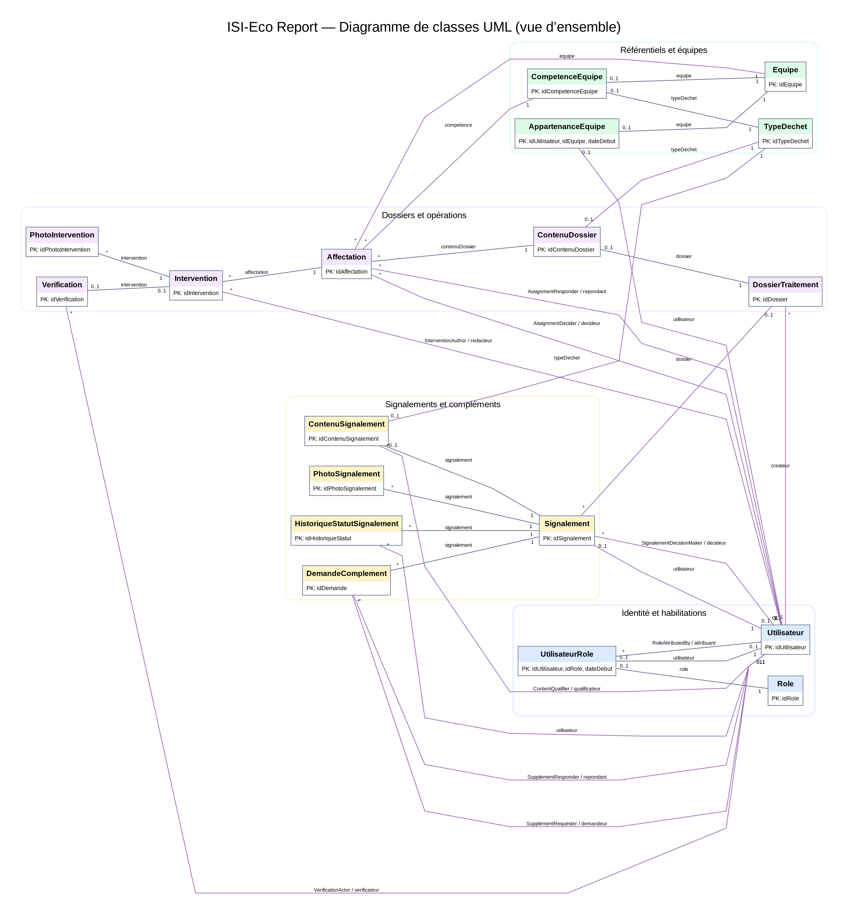

# Livrables UML

Les sources textuelles, diagrammes et conventions UML sont versionnés dans ce dossier.

## Diagramme de contexte

Source et explications : [contexte-systeme.md](contexte-systeme.md).

## Diagramme de cas d’utilisation

- [Présentation et conventions](cas-utilisation.md)
- [Description détaillée par acteur](cas-utilisation-par-acteur.md)

## Diagramme de classes

[Ouvrir les classes, attributs, clés et associations](diagramme-classes.md).

Les vues PNG par domaine sont générées depuis \`prisma/schema.prisma\` par \`scripts/render-uml-class-diagrams.py\` :

- [Identité et habilitations](diagramme-classes-identite-engagement.png)
- [Référentiels et équipes](diagramme-classes-referentiels-equipes.png)
- [Signalements et compléments](diagramme-classes-signalements-qualification.png)
- [Dossiers et opérations](diagramme-classes-dossiers-operations.png)

Le diagramme courant représente 18 modèles. Toute évolution de \`schema.prisma\` doit garder le script de génération, le diagramme Mermaid et ces vues synchronisés.

## Vue relationnelle

Cette vue historique sert de repère visuel, mais ne doit pas être utilisée comme inventaire du modèle courant si elle n'a pas été régénérée depuis le schéma simplifié. Les colonnes et clés de référence sont définies dans [schema.prisma](../../prisma/schema.prisma).

## Référence

La source de vérité physique est le schéma Prisma courant. La correspondance conceptuelle, les champs techniques et les limites de migration sont explicités dans [le diagramme de classes](diagramme-classes.md) et [la documentation Merise](../merise/README.md).
