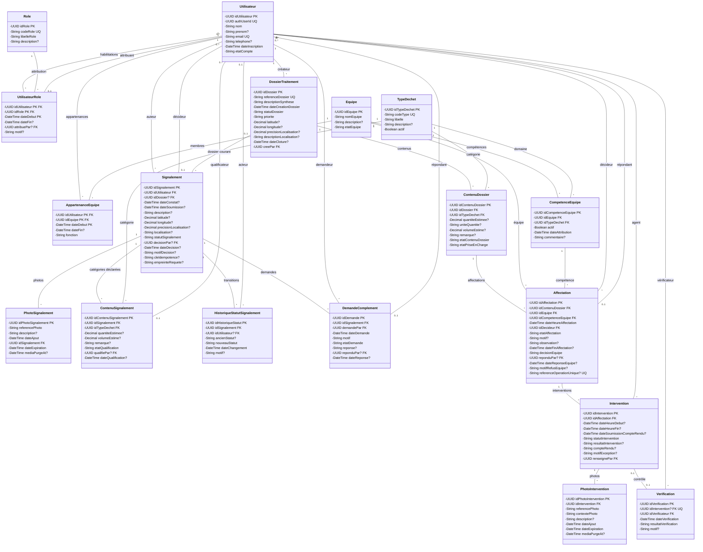

# Diagramme de classes UML simplifié — ISI-Eco Report

## Source et périmètre

Ce diagramme décrit le modèle métier simplifié livré dans `prisma/schema.prisma`. Il contient **18 classes persistées**. Les propriétés scalaires, clés et associations correspondent au schéma Prisma ; les champs techniques d'intégration restent identifiés dans la section dédiée.

Le nom conceptuel **Dossier** est traduit dans le code par `DossierTraitement`, et dans PostgreSQL par `dossier_traitement`, pour préserver le nom physique historique.

## Classes, attributs et associations

## Correspondance conceptuel, Prisma et PostgreSQL

| Classe conceptuelle | Modèle Prisma | Table PostgreSQL |
|---|---|---|
| Utilisateur | `Utilisateur` | `utilisateur` |
| Role | `Role` | `role` |
| UtilisateurRole | `UtilisateurRole` | `utilisateur_role` |
| TypeDechet | `TypeDechet` | `type_dechet` |
| Equipe | `Equipe` | `equipe` |
| AppartenanceEquipe | `AppartenanceEquipe` | `appartenance_equipe` |
| CompetenceEquipe | `CompetenceEquipe` | `competence_equipe` |
| Signalement | `Signalement` | `signalement` |
| PhotoSignalement | `PhotoSignalement` | `photo_signalement` |
| ContenuSignalement | `ContenuSignalement` | `contenu_signalement` |
| HistoriqueStatutSignalement | `HistoriqueStatutSignalement` | `historique_statut_signalement` |
| DemandeComplement | `DemandeComplement` | `demande_complement` |
| Dossier | `DossierTraitement` | `dossier_traitement` |
| ContenuDossier | `ContenuDossier` | `contenu_dossier` |
| Affectation | `Affectation` | `affectation` |
| Intervention | `Intervention` | `intervention` |
| PhotoIntervention | `PhotoIntervention` | `photo_intervention` |
| Verification | `Verification` | `verification` |

## Écarts et champs techniques assumés

- `authUserId` relie le profil métier à Supabase Auth. Les mots de passe et sessions restent hors du modèle métier.
- `cleIdempotence` et `empreinteRequete` assurent l'idempotence des dépôts ; ils sont stockés sur `Signalement`.
- `dateExpiration` et `mediaPurgeAt` servent à la rétention et à la purge des médias.
- Les photos utilisent actuellement `referencePhoto`, qui désigne la référence de stockage privée. Le modèle ne sépare pas encore le chemin, le nom de fichier et le type MIME en trois attributs distincts.
- `UtilisateurRole` et `AppartenanceEquipe` gardent des clés primaires composites temporelles. Cela conserve l'historique des périodes de rôle et d'appartenance.
- `Verification.idIntervention` est nullable pour les anciennes vérifications qui ne peuvent pas être rattachées sans ambiguïté à une intervention. La clé est unique lorsqu'elle est renseignée.
- `localisation` de `Signalement` est mappée sur la colonne SQL historique `description_localisation`. Le modèle Dossier conserve son propre champ `descriptionLocalisation`.

Ces écarts doivent être explicitement acceptés dans la spécification PFE ou corrigés dans un changement de modèle distinct. Le nombre de classes égal à 18 ne suffit pas à démontrer une conformité attribut par attribut.

## Migration et limites de conservation

La migration `20261105000000_simplified_domain_model` transforme l'ancien schéma de 38 modèles vers les 18 tables cibles. Elle conserve les données courantes utiles au nouveau périmètre mais ne conserve pas tous les historiques de l'ancien système :

- le rattachement actif d'un signalement est copié dans `signalement.id_dossier`; les rattachements terminés sont supprimés ;
- la dernière qualification par couple signalement/catégorie est fusionnée dans `contenu_signalement`; les versions antérieures et certains attributs de qualification ne sont pas repris ;
- les réponses sont fusionnées dans `demande_complement` ;
- les vérifications sont appariées chronologiquement aux interventions d'une même affectation ; celles qui ne trouvent pas d'intervention restent sans lien ;
- seuls les événements présentant un changement de statut exploitable sont copiés dans `historique_statut_signalement` ;
- les périodes de validité des types et compétences sont réduites à un booléen `actif` et une date d'attribution pour la compétence ;
- les fonctions retirées du modèle, leurs historiques et leurs colonnes sont supprimés.

La migration doit être répétée sur une copie réaliste de la base avant tout déploiement persistant. Le scénario CI synthétique couvre les chemins de transformation, mais ne remplace pas une sauvegarde restaurable ni l'analyse des volumes réels.
