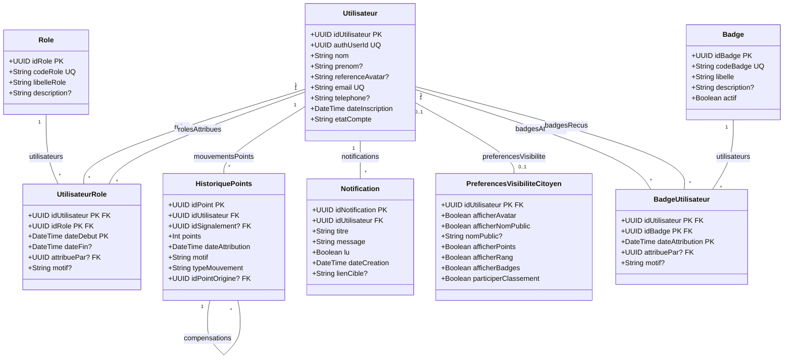
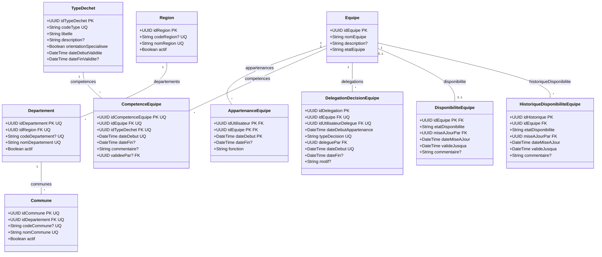
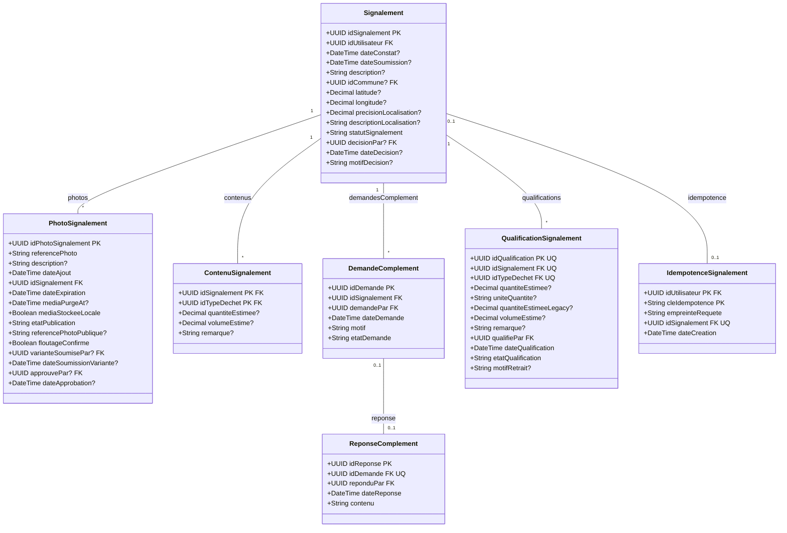
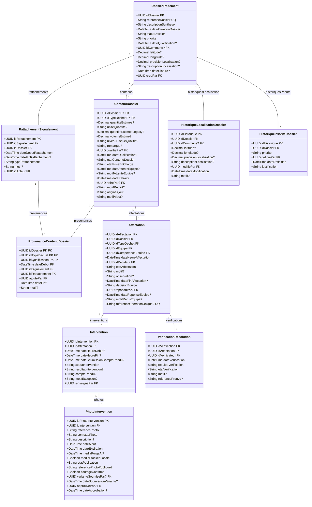
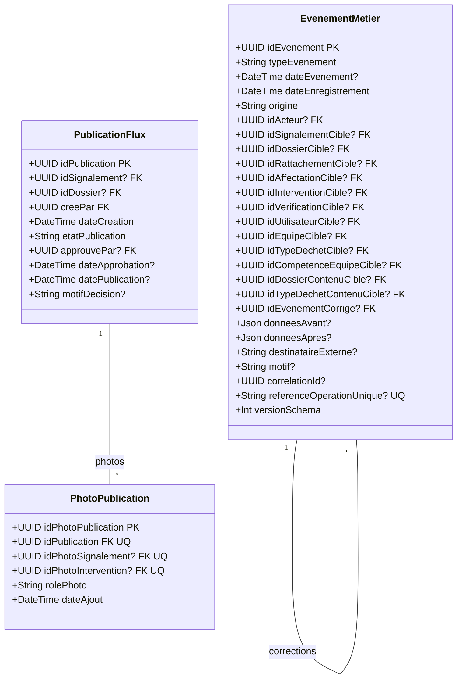

# Diagramme de classes UML — ISI-Eco Report

Ce livrable est généré à partir du schéma `prisma/schema.prisma` de la branche `main`. Il décrit les **38 classes métier**, les attributs scalaires, les clés et les associations définies par Prisma.

Les diagrammes sont séparés en cinq domaines métier pour rester lisibles. Les propriétés de navigation Prisma sont représentées par les associations plutôt que répétées comme attributs.

## Conventions de lecture

- `PK` : propriété composant la clé primaire, y compris une clé composite.
- `FK` : propriété utilisée comme clé étrangère dans une relation Prisma.
- `UQ` : propriété couverte par une contrainte d'unicité déclarée dans Prisma.
- `?` après un attribut : valeur nullable.
- Les associations affichent les multiplicités déduites des relations singulières ou en collection déclarées dans Prisma.
- `auth.users` et les sessions ne sont pas des classes métier de ce modèle : l'identité et les sessions sont gérées par Supabase Auth.

## Identité et engagement

## Référentiels et équipes

## Signalements et qualification

## Dossiers et opérations

## Traçabilité et diffusion

## Associations inter-domaines

Les associations entre classes de domaines différents sont listées ici. Les classes correspondantes apparaissent dans les diagrammes de leurs domaines respectifs.

| Domaine source | Classe et propriété | Domaine cible | Classe cible |
|---|---|---|---|
| Identité et engagement | `Utilisateur.appartenances` | Référentiels et équipes | `AppartenanceEquipe` |
| Identité et engagement | `Utilisateur.competencesValidees` | Référentiels et équipes | `CompetenceEquipe` |
| Identité et engagement | `Utilisateur.signalements` | Signalements et qualification | `Signalement` |
| Identité et engagement | `Utilisateur.signalementsDecides` | Signalements et qualification | `Signalement` |
| Identité et engagement | `Utilisateur.photosSignalementSoumises` | Signalements et qualification | `PhotoSignalement` |
| Identité et engagement | `Utilisateur.photosSignalementApprouvees` | Signalements et qualification | `PhotoSignalement` |
| Identité et engagement | `Utilisateur.dossiersCrees` | Dossiers et opérations | `DossierTraitement` |
| Identité et engagement | `Utilisateur.rattachementsActes` | Dossiers et opérations | `RattachementSignalement` |
| Identité et engagement | `Utilisateur.contenusQualifies` | Dossiers et opérations | `ContenuDossier` |
| Identité et engagement | `Utilisateur.contenusRetires` | Dossiers et opérations | `ContenuDossier` |
| Identité et engagement | `Utilisateur.affectationsDecidees` | Dossiers et opérations | `Affectation` |
| Identité et engagement | `Utilisateur.affectationsRepondues` | Dossiers et opérations | `Affectation` |
| Identité et engagement | `Utilisateur.interventionsRenseignees` | Dossiers et opérations | `Intervention` |
| Identité et engagement | `Utilisateur.verificationsEffectuees` | Dossiers et opérations | `VerificationResolution` |
| Identité et engagement | `Utilisateur.evenementsAgis` | Traçabilité et diffusion | `EvenementMetier` |
| Identité et engagement | `Utilisateur.evenementsUtilisateurCible` | Traçabilité et diffusion | `EvenementMetier` |
| Identité et engagement | `Utilisateur.demandesComplement` | Signalements et qualification | `DemandeComplement` |
| Identité et engagement | `Utilisateur.reponsesComplement` | Signalements et qualification | `ReponseComplement` |
| Identité et engagement | `Utilisateur.qualifications` | Signalements et qualification | `QualificationSignalement` |
| Identité et engagement | `Utilisateur.provenancesAjoutees` | Dossiers et opérations | `ProvenanceContenuDossier` |
| Identité et engagement | `Utilisateur.idempotences` | Signalements et qualification | `IdempotenceSignalement` |
| Identité et engagement | `Utilisateur.delegationsRecues` | Référentiels et équipes | `DelegationDecisionEquipe` |
| Identité et engagement | `Utilisateur.delegationsPar` | Référentiels et équipes | `DelegationDecisionEquipe` |
| Identité et engagement | `Utilisateur.disponibilitesModifiees` | Référentiels et équipes | `DisponibiliteEquipe` |
| Identité et engagement | `Utilisateur.historiquesDisponibilite` | Référentiels et équipes | `HistoriqueDisponibiliteEquipe` |
| Identité et engagement | `Utilisateur.historiquesLocalisation` | Dossiers et opérations | `HistoriqueLocalisationDossier` |
| Identité et engagement | `Utilisateur.historiquesPriorite` | Dossiers et opérations | `HistoriquePrioriteDossier` |
| Identité et engagement | `Utilisateur.publicationsCreees` | Traçabilité et diffusion | `PublicationFlux` |
| Identité et engagement | `Utilisateur.publicationsApprouvees` | Traçabilité et diffusion | `PublicationFlux` |
| Identité et engagement | `Utilisateur.photosInterventionSoumises` | Dossiers et opérations | `PhotoIntervention` |
| Identité et engagement | `Utilisateur.photosInterventionApprouvees` | Dossiers et opérations | `PhotoIntervention` |
| Référentiels et équipes | `TypeDechet.contenusSignalement` | Signalements et qualification | `ContenuSignalement` |
| Référentiels et équipes | `TypeDechet.contenusDossier` | Dossiers et opérations | `ContenuDossier` |
| Référentiels et équipes | `TypeDechet.qualifications` | Signalements et qualification | `QualificationSignalement` |
| Référentiels et équipes | `TypeDechet.evenementsCible` | Traçabilité et diffusion | `EvenementMetier` |
| Référentiels et équipes | `Equipe.affectations` | Dossiers et opérations | `Affectation` |
| Référentiels et équipes | `Equipe.evenementsCible` | Traçabilité et diffusion | `EvenementMetier` |
| Référentiels et équipes | `CompetenceEquipe.affectations` | Dossiers et opérations | `Affectation` |
| Référentiels et équipes | `CompetenceEquipe.evenementsCible` | Traçabilité et diffusion | `EvenementMetier` |
| Référentiels et équipes | `Commune.signalements` | Signalements et qualification | `Signalement` |
| Signalements et qualification | `Signalement.rattachements` | Dossiers et opérations | `RattachementSignalement` |
| Signalements et qualification | `Signalement.provenances` | Dossiers et opérations | `ProvenanceContenuDossier` |
| Signalements et qualification | `Signalement.evenementsCible` | Traçabilité et diffusion | `EvenementMetier` |
| Signalements et qualification | `Signalement.mouvementsPoints` | Identité et engagement | `HistoriquePoints` |
| Signalements et qualification | `Signalement.publications` | Traçabilité et diffusion | `PublicationFlux` |
| Signalements et qualification | `PhotoSignalement.publications` | Traçabilité et diffusion | `PhotoPublication` |
| Référentiels et équipes | `Commune.dossiers` | Dossiers et opérations | `DossierTraitement` |
| Dossiers et opérations | `DossierTraitement.evenementsCible` | Traçabilité et diffusion | `EvenementMetier` |
| Dossiers et opérations | `DossierTraitement.publications` | Traçabilité et diffusion | `PublicationFlux` |
| Dossiers et opérations | `RattachementSignalement.evenementsCible` | Traçabilité et diffusion | `EvenementMetier` |
| Dossiers et opérations | `ContenuDossier.evenementsCible` | Traçabilité et diffusion | `EvenementMetier` |
| Dossiers et opérations | `Affectation.evenementsCible` | Traçabilité et diffusion | `EvenementMetier` |
| Dossiers et opérations | `Intervention.evenementsCible` | Traçabilité et diffusion | `EvenementMetier` |
| Dossiers et opérations | `PhotoIntervention.publications` | Traçabilité et diffusion | `PhotoPublication` |
| Dossiers et opérations | `VerificationResolution.evenementsCible` | Traçabilité et diffusion | `EvenementMetier` |
| Signalements et qualification | `QualificationSignalement.provenances` | Dossiers et opérations | `ProvenanceContenuDossier` |
| Référentiels et équipes | `Commune.historiquesLocalisation` | Dossiers et opérations | `HistoriqueLocalisationDossier` |

## Source de vérité et limites

Le schéma Prisma reste la source de vérité pour les attributs, types, clés et relations déclarées. Ce diagramme ne représente pas les méthodes des services applicatifs : les opérations métier sont spécifiées dans les cas d'utilisation. Les contraintes SQL complémentaires, les règles conditionnelles, les cardinalités métier et les transitions d'état doivent être documentées et testées séparément.
